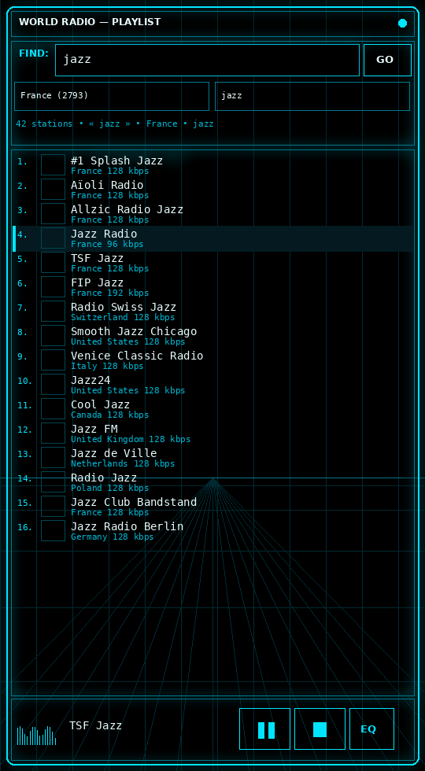
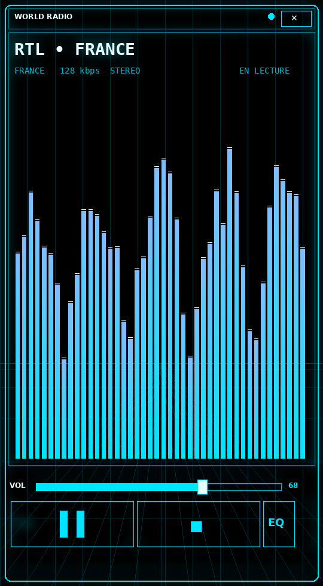

# 📻 World Radio

Application Android **native (Java)** pour écouter des radios du monde entier, avec recherche par pays et par style, logos des stations, égaliseur 8 bandes et **lecture en arrière-plan**.

Thème visuel **Tron** : noir absolu, cyan néon, halos lumineux, grille en perspective.

---

## ✨ Fonctionnalités

| Fonction | Détail |
|---|---|
| 🌍 **Catalogue mondial** | API publique [Radio Browser](https://www.radio-browser.info/) — dizaines de milliers de stations, sans clé |
| 🔎 **Recherche** | Par nom de radio, ville, pays… |
| 🌐 **Filtres** | Sélecteur de **pays** (225 pays) et de **style** (pop, jazz, rock, news…) |
| 🖼️ **Logos** | Chargement asynchrone avec cache mémoire |
| ▶️ **Lecture** | Flux MP3 / AAC via `MediaPlayer` |
| 🎚️ **Égaliseur 8 bandes** | 60 Hz → 16 kHz, ±12 dB, presets Flat / Bass / Vocal / Rock, réglages memorisés |
| 🎧 **Arrière-plan** | Service de premier plan + notification avec bouton Stop |
| 🔁 **Reconnexion** | 2 tentatives automatiques + garde-fou 25 s sur flux morts |
| 🔊 **Focus audio** | Pause automatique pendant un appel, reprise ensuite |
| 🎨 **Thème Tron** | Lueurs réelles (`BlurMaskFilter`), grille en perspective, spectre néon |

## 📥 Installation (APK prêt à l'emploi)

1. Ouvrez la page **[Releases](../../releases/latest)**
2. Téléchargez le fichier `WorldRadio-<version>-debug.apk`
3. Sur le téléphone, autorisez l'installation depuis cette source si demandé
   *(Paramètres → Applications → Accès spéciaux → Installer des applis inconnues)*
4. Installez et lancez **World Radio**

> L'APK est signé avec une clé **debug** : il convient au test personnel, pas à une publication sur le Play Store.

## 🚀 Utilisation

1. L'écran d'accueil liste les stations les plus écoutées au monde
2. Utilisez **FIND:** pour chercher, et les deux sélecteurs pour filtrer par pays / style
3. Touchez une station pour l'écouter
4. Touchez le nom de la station en bas pour ouvrir le **lecteur plein écran**
   - Gros boutons **Play / Stop / EQ**
   - Curseur de **volume** relié au volume média du téléphone
   - **Spectre** animé (réel si la permission `RECORD_AUDIO` est accordée, sinon décoratif)

## 🛠️ Compilation depuis les sources

Pré-requis :
- **JDK 17**
- **Android SDK Platform 35** + Build-Tools 35 (`ANDROID_HOME`)
- **Gradle 8.13**

```bash
git clone https://github.com/philippe015/world-radio.git
cd world-radio
export ANDROID_HOME=$HOME/Android/Sdk
gradle assembleDebug
```

L'APK est produit dans :

```
app/build/outputs/apk/debug/app-debug.apk
```

### ⚠️ Note pour les machines ARM (aarch64)

`aapt2` n'est distribué qu'en **x86_64** par Google. Sur un ordinateur ARM, il faut soit :

- passer par l'émulation : `qemu-user-static` + un wrapper `aapt2` pointé par
  `android.aapt2FromMavenOverride=/chemin/vers/aapt2`
- soit compiler dans la CI GitHub Actions (runners x86_64), plus simple

## 🧱 Architecture

```
app/src/main/java/fr/cyberpunk/worldradio/
├── MainActivity.java       # playlist, recherche, filtres
├── PlayerActivity.java     # lecteur plein écran
├── EqualizerActivity.java  # égaliseur 8 bandes
├── RadioService.java       # service de lecture en arrière-plan
├── RadioApi.java           # client Radio Browser
├── RadioStation.java
├── Country.java
├── StationAdapter.java
├── ImageLoader.java        # chargement des logos (LruCache)
├── AudioState.java         # état partagé
├── VisualizerView.java     # spectre (néon / classique)
├── TronBackgroundView.java # grille en perspective + scanline
├── NeonPanel.java          # châssis à halo
├── GlowButton.java         # bouton texte néon
└── GlowImageButton.java    # bouton icône néon
```

## 📸 Aperçu du thème

> Illustrations du design (rendu cible), pas des captures d'écran.

| Playlist | Lecteur |
|---|---|
|  |  |

## ⚠️ Limites connues

- `MediaPlayer` ne lit pas tous les flux **HLS (`.m3u8`)** ou **HE-AAC** — passer à ExoPlayer serait la suite logique
- L'égaliseur utilise l'API matérielle `Equalizer` : le nombre réel de bandes dépend de l'appareil (souvent 5) ; les 8 curseurs sont répartis sur les bandes matérielles les plus proches
- Le spectre « réel » nécessite la permission `RECORD_AUDIO` (exigence Android) ; l'app n'enregistre rien, elle analyse uniquement sa propre sortie audio
- Pas de favoris ni d'historique pour l'instant

## 📄 Licence

[MIT](LICENSE) — les métadonnées des stations proviennent de Radio Browser (communauté, licence ouverte).

## 🙏 Crédits

- [Radio Browser](https://www.radio-browser.info/) — annuaire public de stations
- Projet développé et compilé avec [DeepSeek Harness](https://github.com/)
